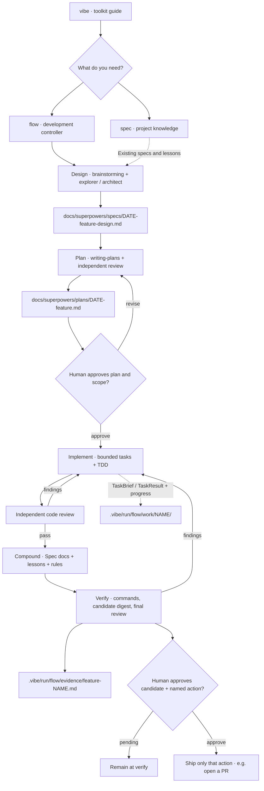
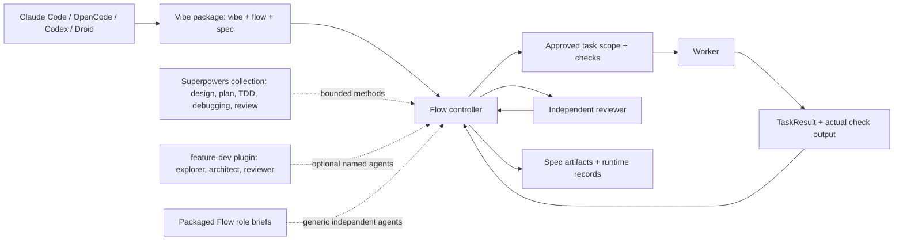

<div align="center">


**Spec-first structure for coding with agents.**

[](https://github.com/LennardZuendorf/vibe/actions/workflows/ci.yml)
[](LICENSE)


</div>

---

**One toolkit guide, a controlled development flow, and durable project knowledge.**

vibe is three small, independent tools for coding with agents: **spec**
(durable planning memory), **flow** (workflow, bounded delegation and review),
and **instruct** (the deferred instruction API). The entry skill **vibe** explains
the toolkit; **flow** and **spec** can each be invoked directly. Flow combines
Rust state/policy checks with the existing Node/Bash instruction adapters.
Complete native action blocking and trusted human approval are not yet available.

|  | **spec** | **flow** | **instruct** |
|---|---|---|---|
| **What it is** | Durable `docs/spec/` planning layer — product / tech / design / plan / lessons — with templates and a validator. | State-machine workflow: routes each phase to the right skills, injects per-turn orders, guards its own write invariants with hooks. | ⏳ Planned — layered, budgeted instruction injection (global → repo → local → session tiers). |
| **Works with** | Any coding agent, or none. | Claude Code, OpenCode, and Factory Droid via `/flow`; Codex via skill invocation. Hooks are Claude Code-only. Other agents read the same rules as prose. | Claude Code + OpenCode, both ⏳ planned. |
| **Needs** | `bash`; the `vibe-spec` binary (dev build) for validation | `bash`; Node ≥18 for instruction composition; `vibe-flow` for the Rust runtime. | Nothing today (unbuilt) — a static Rust binary in v0.4. |
| **Install** | `./install.sh <repo> --only spec` | `./install.sh <repo> --only flow` | ⏳ planned: `./install.sh <repo> --only instruct` |
| **Deep dive** | [`spec/README.md`](spec/README.md) | [`flow/README.md`](flow/README.md) | [`docs/spec/tech/instruct.md`](docs/spec/tech/instruct.md) |

This repo builds itself with its own harness, so what you install is what is
dogfooded here.

## Shipped today (v0.3.x, plus the vibe-spec dev build)

Everything in this section is real, installable, and tested right now.
Commands are byte-exact — copy them as written.

### From request to a reviewed change

Flow owns the lifecycle. Spec owns artifact locations. External skills supply
bounded methods, and independent agents do scoped work. The controller is the
main agent coordinating the conversation; it is not an extra plugin.



This is the lifecycle contract, not a claim of full enforcement. Legacy v1
uses human gates by convention. Opt-in v2 denies implementation and ship entries
while trusted approval/evidence are unavailable. Never bypass that denial through
legacy writers. A receipt or candidate digest is an observation, not approval.

### Where external skills and plugins fit



| Component | Contribution | Availability and boundary |
| --- | --- | --- |
| [Superpowers](https://github.com/obra/superpowers) | `brainstorming`, `writing-plans`, `test-driven-development`, `systematic-debugging`, `receiving-code-review`, `verification-before-completion`, `requesting-code-review` | Use one method for its assigned step. Flow does not hand off to whole-lifecycle executors or automatic branch finishing. Missing helpers use the bounded Flow procedure. |
| `feature-dev` | Optional native `code-explorer`, `code-architect`, `code-reviewer` agents | If absent, dispatch generic agents with [Flow's role briefs](flow/agents/). Required independent review still blocks readiness if no independent agent is available. |
| Vibe's host packages | Discover the skills and expose the supported host entrypoints | Packaging is distinct from external methods. Flow hooks are wired only for Claude Code in this slice; see [platform support](#platform-support). |
| GSD compatibility | Read existing `.planning/` documents as context | [Alias data](flow/gsd.md) is not a second lifecycle or installed execution engine. Flow does not write GSD's state store. |

`install.sh --with-plugins` currently installs only the Superpowers companion via
the Claude CLI. It does not install feature-dev or provision companions across
all hosts. [The dependency manifest](flow/reference/deps.json) and
[bounded method mapping](flow/reference/compatibility.md#bounded-method-selection)
define the current integration. Models follow the user's/repository's preferences;
a role name does not select a model.

### Example: add CSV export

For a hypothetical Rust CLI, the request is: “Add `report export --format csv`.”

1. **Explore and design.** The controller loads project specs and lessons. A
   `code-explorer` traces reporting and CLI code; a `code-architect` proposes the
   encoder and command boundary. `brainstorming` resolves columns, escaping and
   output behavior with the user. Spec places the design in the feature layer.
2. **Plan and approve.** `writing-plans` turns the design into scoped tasks:
   `export-1` encoder, `export-2` CLI wiring, `export-3` docs. An independent
   reviewer checks the plan before the user approves it. The plan then freezes.
3. **Implement and review.** An implementer uses TDD for `export-1`, returning
   changed paths and actual test output. The controller checks the result;
   `code-reviewer` reviews it independently. `export-2` waits for the checked
   encoder result. Failures use `systematic-debugging`; review findings use
   `receiving-code-review`. Workers do not commit or advance the cursor.
4. **Compound and verify.** Prepare usage docs, durable decisions and lessons.
   Run affected tests and final checks; a reviewer examines the whole candidate,
   including docs. Keep progress and output in `.vibe/run/flow/`, outside the
   frozen plan. Changed candidate bytes require fresh affected checks and review.
5. **Ship the approved action.** “Commit, push and open a PR” authorizes those
   actions only after verification. It does not authorize merge, release or
   cleanup. In adopted v2 this remains blocked until trusted authority exists;
   the current legacy workflow relies on the controller honoring the user's gate.

See the [detailed walkthrough and artifact map](flow/README.md#worked-example-csv-export)
for task scopes, handoffs and the exact records involved.

## Install

**Prerequisites:** `bash` and `curl` (or `wget`), plus `git` for the target repo.
[`jq`](https://jqlang.github.io/jq/) and [Node](https://nodejs.org) ≥18 are
recommended — both halves degrade without them, but with no Node the flow's
hooks fall back to bash (guard, Stop gate) or go quiet. The `claude` CLI is needed only for the optional `--global --plugin` (and `--with-plugins`).

No clone required — run from inside the repo you want vibe in:

```bash
curl -fsSL https://raw.githubusercontent.com/LennardZuendorf/vibe/main/install.sh | bash
```

It fetches a snapshot (override with `VIBE_REF=<branch|tag>`) and installs
into the enclosing repo. Pass flags after `bash -s --`. Or, from a clone:

```bash
git clone https://github.com/LennardZuendorf/vibe.git && cd vibe
./install.sh <target-repo>
```

A bare run searches upward for the enclosing repo (a `docs/spec`/`.git` marker)
and, on a terminal, asks which mode you want.

**Where it installs.** Run from anywhere inside a repository or Git worktree —
the nearest repo/worktree root is the target, not the directory you ran from. A
plain directory with no Git ancestor uses the current directory.

| Mode | Command | What you get |
|---|---|---|
| **local** (default) | `./install.sh <repo>` | The full **stateful** kit at the resolved root: the `vibe`, `flow` and `spec` skills, the engine, and the native surface of every configured host. For Claude Code that is `/flow` plus the hooks wired via `.claude/settings.json`. |
| **global** | `./install.sh --global` | The **per-user skills**: `vibe`, `flow` and `spec` installed into each selected host's own user-level skills dir (Claude `~/.claude/skills`, Codex `~/.codex/skills`, Droid `~/.factory/skills`, OpenCode `~/.config/opencode/skills`) plus one shared `~/.agents/AGENTS.md` block. No host CLI needed, and re-running it changes nothing. It also reports the `vibe-spec` binary status (absent by default — see [The `vibe-spec` binary](#the-vibe-spec-binary)); `--build-spec-bin` builds and installs it. `--host <claude\|codex\|droid\|opencode\|all>` overrides detection; `--plugin` also installs the Claude plugin for its doctrine hook. |

```bash
./install.sh <repo> --only spec       # the spec framework alone
./install.sh <repo> --only flow       # the flow harness alone
./install.sh <repo> --adapters claude # symlink CLAUDE.md -> AGENTS.md (opt-in)
./install.sh <repo> --with-plugins    # also install companion plugins (superpowers)
./install.sh <repo> --dry-run         # print the plan, write nothing
```

**Host selection.** With no flag, the installer detects the `claude`,
`opencode`, `codex`, and `droid` CLIs on `PATH` and configures only the hosts it
finds. If it finds none, the host-neutral core still installs and the summary
prints the explicit selection syntax. `--platform LIST` overrides detection in
both directions — the listed hosts are configured whether or not their CLIs are
present:

```bash
./install.sh <repo> --platform claude,codex   # only these two hosts
./install.sh <repo> --platform none           # host-neutral files only
```

`--platform` takes a comma-separated list of `claude`, `opencode`, `codex`,
`droid`, or `none`; the **last** `--platform` flag wins, and `none` cannot be
combined with a host. What each host gets is in
[Platform support](#platform-support).

The repo is its own plugin marketplace, if you would rather skip the
installer:

```bash
claude plugin marketplace add LennardZuendorf/vibe
claude plugin install vibe@vibe
```

Uninstall removes only what the installer created — `docs/spec/**`, `AGENTS.md`
prose, unrelated hooks, and the flow cursor (unless `--yes`) survive:

```bash
./install.sh <repo> --uninstall             # cursor kept; --dry-run to preview
./install.sh <repo> --uninstall --yes       # also remove the flow cursor
./install.sh <repo> --uninstall --only flow # remove one half, leave the other
```

Every install records the artifacts it created in `.vibe/install-manifest.json`
(deliberately not gitignored), which is what makes re-install idempotent and
`--uninstall` safe: it removes only the recorded vibe-owned paths and preserves
user files in every shared directory. A repeat run leaves the managed files
byte-stable and keeps your live cursor and evidence receipts. `--uninstall`
inverts every host, regardless of `--platform`.

#### The `vibe-spec` binary

`/spec validate`, `vibe-spec root` and the spec hooks call the `vibe-spec`
binary. A plain install does **not** ship it (no release artifacts exist yet), so
`./install.sh --global` prints its status instead of pretending the skill set is
complete. Two ways to get it:

```bash
./install.sh --global --build-spec-bin      # build from this checkout, install to ~/.local/bin
cargo install --locked --path crates/vibe-spec   # from a clone
vibe-spec --version                              # confirm which binary you got
```

`--bin-dir DIR` puts it somewhere else; the installer prints a note when that
directory is not on PATH (it never edits a shell profile). Without the binary the
harness still runs: the `spec` skill reports the absence and falls back to the
bundled bash scripts, which validate a **flat legacy** root only. A layered
`docs/spec/` tree cannot be validated at all — the skill says so in its finish
line rather than claiming a pass. `doctor.sh` reports the same status as
`tool.vibe-spec`, and `install.sh` never fails because the binary is missing.

### spec — the planning layer

Every vibe project gets a `docs/spec/` tree, the single source of truth for what
you are building, why, and how:

```text
docs/spec/
├── product.md, tech.md, design.md, plan.md, lessons.md   ← ROOT: persistent role, current content
└── features/<name>/
    ├── product.md    required     what this feature does
    ├── tech.md       required     how it is built
    ├── plan.md       recommended  stable <name>/n unit IDs; verification per unit
    ├── design.md     optional     UI/UX or design-system fragment
    └── research.md   optional     findings from spikes / investigations
```

Root files carry no backlog. Flow retains feature artifacts after implementation.
Compound prepares additive durable docs before final verification; destructive
promotion or removal needs separate authorization. **Code is truth.**

```bash
/spec setup            # initialise docs/spec/ with templates
/spec strategy         # write root product/tech/design/plan
/spec feature <name>   # scope and design a named feature
/spec validate         # check structural consistency
```

The `/spec` skill is Markdown and bash. Validation (`/spec validate`) runs the
`vibe-spec` binary, which is a Rust dev build today (see [Install](#install)).

### flow — the workflow harness

Everything starts at `idle`. The primary cursor `.vibe/run/flow/state.json` —
legacy v1 fields `{flow, phase, feature, updated}` — points at one of 14 states in `state-machine.json`,
the source of truth for each state's skill, delegates, write surface, and
legal `next`.

```bash
/flow feature.design my-feature   # start a feature; names the feature
/flow feature.plan                # advance to planning
/flow idle                        # legacy v1 abort; adopted v2 needs explicit abort
```

The feature sequence is design → plan → impl → compound → verify → ship.
Plan → impl and verify → ship need human approval. Legacy v1 follows this by
convention; explicit v2 adoption enforces legal edges and revisions. Production
trusted approval/evidence remain unavailable/deny, so v2 implementation and ship
entries are closed. No confirm token supplies authority. See
[Flow authorization](flow/reference/authorization.md).

| Hook | Does | Without Node |
|---|---|---|
| `SessionStart` | Re-injects the working-model doctrine each session (and on `compact`). | quiet |
| `UserPromptSubmit` | Every turn, two byte-stable lines naming the state and its transition command; full orders on the turn after the cursor moves. | quiet |
| `PreToolUse` | Guards the write invariants on file-tool calls (Edit/Write/MultiEdit/NotebookEdit/Bash); on `Bash` it only warns. | **still blocks**, via `flow/hooks-fallback/` |
| `Stop` | Warn-first exit checks; blocks in `*.verify` without a fresh evidence receipt. | **still blocks**, via `flow/hooks-fallback/` |

Rust provides state, policy and guard/Stop; JS still composes injection through a zero-dependency Node engine ([`flow/engine/`](flow/engine/)).
In an installed repo it is `node .agents/skills/flow/engine/cli.mjs <command>`
— shortened to `vibe` below:

Orders arrive once, on the turn after the cursor moves. If they are lost (a
compaction, a missed turn), `vibe orders` or `bash .agents/skills/flow/scripts/orders.sh`
recovers them.

```bash
vibe state get                             # read the legacy cursor
vibe state set <target>                     # legacy v1 only; refuses adopted v2
vibe orders                                # the current state's orders
vibe doctor                                # install health report (warn-only, always exits 0)
vibe render --list                         # what each injection channel composes, and from where
vibe policy decide <path>                  # the write-invariant verdict for a path
```

A root `vibe.json` (never rewritten by install) turns injected content
blocks on or off and adds your own — see [`flow/README.md` § Injection
config](flow/README.md#injection-config-vibejson). Flow also *delegates* to
external skills declared in [`flow/reference/deps.json`](flow/reference/deps.json)
(reported by `vibe doctor`). They supply bounded methods. Missing independent
review blocks readiness; workers never acquire lifecycle or shipping authority.

### Today's layout

```text
your-repo/                     # after install
├── .agents/skills/
│   ├── spec/                  # the spec framework
│   ├── vibe/                  # toolkit guide
│   └── flow/                  # lifecycle, procedures, state machine, engine
├── .claude/                   # Claude adapter: /flow + hooks + settings.json
├── .opencode/                 # OpenCode: /flow project command
├── plugins/vibe/              # Codex: skill package (+ .agents/plugins/marketplace.json)
├── factory-plugin/            # Factory Droid: /flow + skills (+ .factory-plugin/marketplace.json)
├── .vibe/install-manifest.json # what this install created; --uninstall reads it
├── docs/spec/                 # your durable project memory
└── AGENTS.md                  # merged instructions (CLAUDE.md may symlink here)
```

Each host surface appears only when that host was configured — a Claude-only
install writes `.claude/` and nothing under `.opencode/`, `plugins/`, or
`factory-plugin/`. In **this** repo the canonical halves live at
[`spec/`](spec/) and [`flow/`](flow/); `.agents/skills/{vibe,flow,spec}` are
discovery links. The root guide lives in `skills/vibe/`; owned `using-spec` registrations are retired.

## Tests

```bash
bash tests/run.sh   # spec + flow + adapters + engine suites
bash tests/parity/run.sh # generate and compare current compatibility cases
```

Flow parity generates its current test projects in temporary storage from the
machine and policy. `tests/parity/flow.json` supplies the run configuration; the
checked-in Flow corpus remains a historical reference.

CI runs `shellcheck` on every tracked `*.sh`, the combined suite on Linux and
macOS `bash` 3.2, the engine suite jq-less and from a space-containing path, a
`CLAUDE_PROJECT_DIR` hermeticity leg, `vibe-spec validate --strict`,
`vibe-spec check-drift`, and `vibe-spec migrate --to docs/spec --check`.

## Runtime status and roadmap

| Surface | Current state |
| --- | --- |
| Skills | `vibe` toolkit guide, `flow` lifecycle, standalone `spec`; old owned `using-spec` registrations retired. |
| Rust Flow | State, policy, guard/Stop, explicit v2 adoption, revision checks, task results, recovery and candidate identity exist in `crates/vibe-flow/`. Trusted approval/evidence remain unavailable/deny. |
| Instruction delivery | Existing Node/Bash Flow composition and Claude hooks remain. The shared Instruct API and wider host enforcement are deferred. |
| Spec | `docs/spec/` is the live root here. `vibe-spec` validates it; a plain skill install does not build the binary. |
| Distribution | Existing project/global skill installers and generated host packages remain. See install instructions above for supported flags. |

The source-of-truth roadmap is [docs/spec/plan.md](docs/spec/plan.md), not a list
of assumed available commands. Deferred work is tracked in [#83](https://github.com/LennardZuendorf/vibe/issues/83)
(Rust Instruct API), [#84](https://github.com/LennardZuendorf/vibe/issues/84)
(composition/delivery), [#85](https://github.com/LennardZuendorf/vibe/issues/85)
(host coordination) and [#86](https://github.com/LennardZuendorf/vibe/issues/86)
(Spec integration/promotion). A configured hook or discovered skill does not
prove native action coverage or human-origin approval.

## Platform support

One project install lays down a host-neutral core plus a native surface for each
configured host. Paths below are relative to the installed root.

| Host | Start the flow workflow | Skills live at | Wired per host |
|---|---|---|---|
| **Claude Code** | `/flow` — native project command (`.claude/commands/flow.md`) | `.agents/skills/{vibe,flow,spec}` + `.claude/skills/{vibe,flow,spec}` | All hooks, via `.claude/settings.json`. |
| **OpenCode** | `/flow` — native project command (`.opencode/commands/flow.md`) | `.agents/skills/{vibe,flow,spec}` | No hook integration. |
| **Codex** | Skill invocation only — `$flow` (or the skill picker `/skills`); there is no synthetic `/flow` command | `.agents/skills/{vibe,flow,spec}` + `plugins/vibe/skills` | No hook integration; no native agent registration. |
| **Factory Droid** | `/flow` — native project command (`factory-plugin/commands/flow.md`) | `.agents/skills/{vibe,flow,spec}` + `factory-plugin/skills` | No hook integration; no native droid registration. |
| **Other `AGENTS.md` readers** | Manual — the agent follows the `AGENTS.md` rules as prose | `.agents/skills/{vibe,flow,spec}` (plain files) | No hooks, no native command. |
| **Bare git / any editor** | — (spec framework only) | — | `docs/spec/` docs, templates, `vibe-spec`. |

The **spec** workflow is skill-invoked on every host (the skill is
user-invocable, so hosts that list skills as commands offer it as `/spec`). Hooks are **Claude Code-only** in this slice: OpenCode, Codex,
and Factory Droid get skills and a workflow entry point, not per-turn inject,
guard, or stop-gate wiring — and no host gets native agent/droid registration.
(The `vibe` store hook below is separate and covers all four harnesses.)
The install summary reports a host's hooks only when their wiring actually
installed. Budgeted instruction injection (`instruct`) remains ⏳ planned.

## Global store

`vibe` (crate `crates/vibe`) keeps one user-level store and projects it into Claude Code, Codex, OpenCode and Factory droid. Decision: [D48](docs/spec/decisions/d48-global-store-and-projection.md); tech note: [`cli-store.md`](docs/spec/tech/cli/cli-store.md).

```bash
vibe install [--harness claude,codex] [--dry-run]   # store init, one SessionStart hook per detected harness, OpenCode plugin, then sync
vibe store import-mcp ~/old/mcp.json                # merge servers; secrets become ${VIBE_<SERVER>_<FIELD>}
vibe sync [--dry-run] [--json]                      # full projection, including Claude MCP via `claude mcp add-json`
vibe store status                                   # per-harness drift, skips, conflicts
vibe uninstall [--dry-run]                          # reverse exactly what vibe created; the store stays
```

Store layout (`~/.config/vibe/`):

```text
store.json   # harness switches, extra skill sources
AGENTS.md    # root instructions, the single source
mcp.json     # {"mcpServers":{...}}
skills/      # one dir per skill, each with SKILL.md
```

`install` wires the harnesses it detects (configuration directory present, or its CLI `claude`, `codex`, `opencode`, `droid` on `PATH`); an undetected one gets a note, and `--harness <id>` forces it. Without the `claude` CLI, `install` and `sync` skip the Claude MCP step with one note and exit 0; after you install the CLI, run `vibe sync` once to project MCP.

After install, every harness session start re-projects the store. When something changed, the hook prints one notice line: a `{"systemMessage":"vibe: …"}` JSON line for Claude, Codex and Factory (shown to you), plain text for OpenCode. The hook never injects instruction content and always exits 0. Claude MCP changes need `vibe sync`; until you run it, every session start repeats the notice, and `vibe store status` shows `claude mcp: out of date`. vibe changes only its own marker blocks and the entries it recorded in `state.json`; everything else survives install, sync and uninstall.

**Secrets.** vibe never writes a secret it detects on import. Keep API keys in your environment and reference them as `${NAME}` placeholders in `mcp.json`; `store import-mcp` does the replacement and prints variable names only (`--keep-literals` opts out). An env secret of a valid key `K` becomes `${K}` only when the name is unreserved in the store/input and earlier allocations; otherwise it gets a collision-free `${VIBE_<SERVER>_<FIELD>}` name. Credentials remain independently named across servers, even when their literal values match. Codex stdio cannot rename env variables: import warns and Codex skips an applicable server whose placeholder name differs from its env key. Headers and URLs get server-qualified names. Literals you write into `mcp.json` yourself are projected as written, with a `literal secret-looking value projected` note. URL userinfo is never rewritten and always warns.

Projection allows intentionally linked configuration roots and internal directory links. It refuses symlinked target files and descendant paths that escape the resolved root or cross dangling links. Linked read-only store inputs remain supported.

A heartbeat keeps the exclusive projection lock fresh during CLI work. Age alone does not prove its holder stopped. If a crash leaves a lock, `vibe doctor` identifies it; independently verify the holder stopped, then remove that exact lock file and retry.

| Variable | Effect |
|---|---|
| `VIBE_STORE` | the whole global root (default `~/.config/vibe`): the store files and what later CLI slices keep beside them |
| `VIBE_STATE` | state dir (default `~/.local/state/vibe`) |
| `VIBE_TOOLKIT` | directory holding vibe's own skills, added as a skill source by `install` |
| `VIBE_SPEC_BIN` | `vibe-spec` binary used by `vibe spec …` |

Known limits: Windows skills links are skipped; a Codex `config.toml` with a root inline `mcp_servers = {…}` gets no vibe MCP block.

## Documentation

- [`spec/README.md`](spec/README.md) · [`flow/README.md`](flow/README.md) — each half, standalone.
- [`docs/spec/product.md`](docs/spec/product.md) · [`docs/spec/tech.md`](docs/spec/tech.md) · [`docs/spec/plan.md`](docs/spec/plan.md) — the harness's own specs, a living worked example.
- [`CHANGELOG.md`](CHANGELOG.md) — release notes.

## License

[MIT](LICENSE) © 2026 Lennard Zündorf
