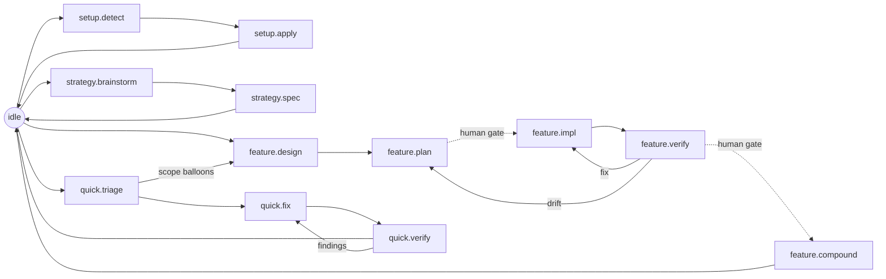

# Workflow Surface

The primary user-facing workflow is the `flow` skill, whose per-phase files
drive each flow:

| Phase file | When | Main Output |
|---|---|---|
| `setup` | Installing or repairing the workflow harness in a project | flow's skill files, adapter files, baseline specs |
| `strategy` | Bootstrapping or refocusing project direction | Root `product.md`/`tech.md`/`design.md`/`plan.md` |
| `feature` | Designing and building a named feature | Spec root's `features/<name>/` plus implementation |
| `quick` | Small fixes and bounded maintenance | Workspace edits, optional `quick/<slug>.md` |
| `verify` | Evidence before completion | Test/build/review findings |
| `compound` | End-of-work consolidation | Lessons, root spec updates, archive moves |

These are phase files of one skill, not hidden prompts. Adapters may expose
shortcuts, but the canonical workflow lives in the `flow` skill.

## Flow at a glance

Everything starts at `idle`; the agent self-locates, then drives one flow
through the `flow` skill. A scope edit is not a state: the agent edits within
the current state's write surface and stays put.

