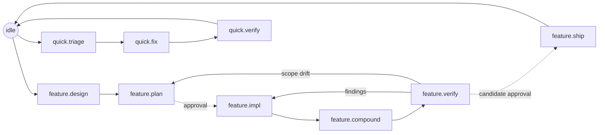

# Workflow Surface

The toolkit guide is `vibe`; the workflow skill is `flow` (`vibe:flow` in a
plugin); `spec` remains independently callable. Owned `using-spec` discovery is
retired. Direct Flow and Spec entry do not require the toolkit guide first.

Flow's `SKILL.md` contains discovery, routing and D12 orders. Load only the
current procedure, relevant reference and bounded agent brief. Generic agents
can consume those briefs when native role registration is unavailable.

| Flow | Purpose | Output |
|---|---|---|
| `setup` | Read-only inventory; route requested repairs through planning | Inventory or explicitly requested scaffolding |
| `strategy` | Agree project direction; request a bounded Spec operation | Durable project knowledge |
| `feature` | Design, plan and implement a named change | Frozen design/plan, task results, reviewed candidate |
| `quick` | At most two files, twenty changed lines, no contract change | Bounded fix and verification |
| `compound` | Prepare additive docs before final checks | Current docs, lessons and generated rules |
| `verify` | Check the integrated candidate independently | Actual checks and review findings |
| `ship` | Perform only an expressly approved named action | Action result; no implicit publication or cleanup |

The controller owns sequencing and progress. Workers receive exact scope and
checks, return TaskResult records and never approve, transition or finish work.
External skills supply bounded methods; whole-lifecycle executors do not own
Flow. Missing independent review blocks readiness.

The machine owns exact legal edges. v1 follows these gates by convention.
Opt-in v2 checks legal progression; production trusted approval/evidence remain
unavailable/deny. Native full blocking is deferred, not implied by this diagram.
See [phase map](phase-map.md) and [contract](../concepts/flow-contract.md).
