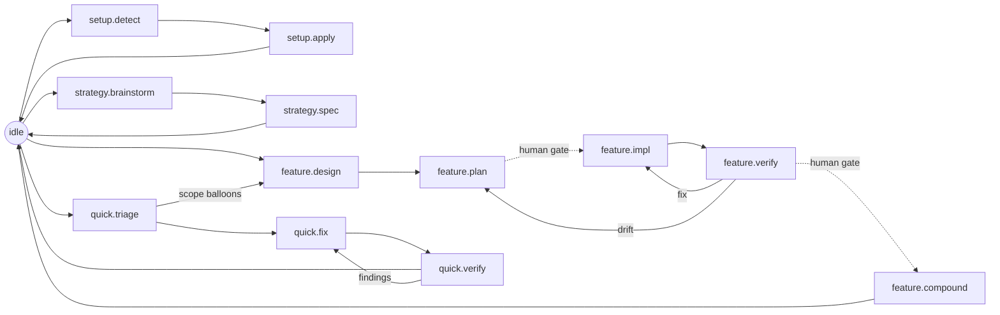

# Workflow Surface

The primary user-facing workflow is the `flow` skill in one `SKILL.md`, whose
state procedures and order blocks drive each flow:

| Flow | When | Main Output |
|---|---|---|
| `setup` | Installing or repairing the workflow harness in a project | flow's skill files, adapter files, baseline specs |
| `strategy` | Bootstrapping or refocusing project direction | Root `product.md`/`tech.md`/`design.md`/`plan.md` |
| `feature` | Designing and building a named feature | `docs/superpowers/specs/` design and `docs/superpowers/plans/` plan; `features/<name>/` is legacy and readable only |
| `quick` | Small fixes and bounded maintenance | Workspace edits, optional `quick/<slug>.md` |
| `verify` | Evidence before completion | Test/build/review findings |
| `compound` | End-of-work consolidation | Lessons, root spec updates, branch finishing |

Adapters may expose shortcuts, but the canonical workflow lives in the `flow`
skill's single `SKILL.md`.

## Flow at a glance

Everything starts at `idle`; the agent self-locates, then drives one flow
through the `flow` skill. A scope edit is not a state: the agent edits within
the current state's write surface and stays put.

