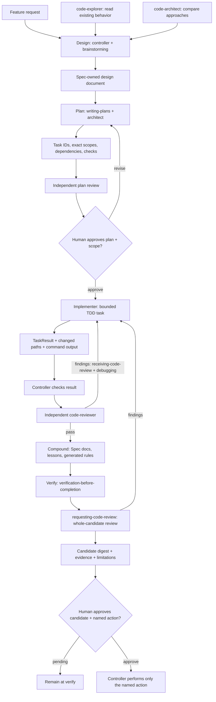
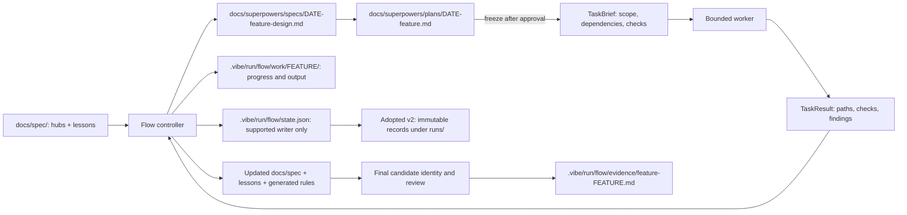
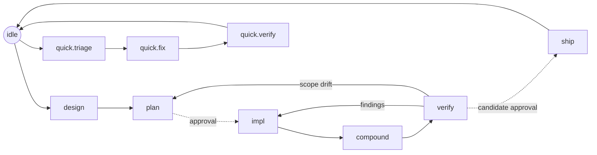

# The vibe flow

> **For humans.** Agents enter [SKILL.md](SKILL.md) as `flow` or `vibe:flow`.
> The root `vibe` skill explains the toolkit; `spec` handles durable knowledge.

Flow supplies bounded procedures, agent briefs and a shared state machine for
Claude Code, OpenCode, Codex and Factory Droid. Rust implements state, policy and
guard/Stop; JS still supplies instruction composition. Legacy v1 uses human gates
by convention. Explicit v2 adoption adds legal progression and task records;
production trusted approval/evidence checks remain unavailable/deny.

Native complete blocking has not been established for any host. Claude hooks,
installed skills and model scenario evaluations do not prove complete action
coverage or human-origin approval. See [authorization](reference/authorization.md).

## Quickstart

```bash
# Install the flow half into your project:
./install.sh /path/to/your/repo --only flow
```

The installer copies the flow core into `<repo>/.agents/skills/flow/`, merges the
`AGENTS.md` instructions block, seeds + gitignores the flow cursor, and — on
Claude Code — writes `.claude/settings.json` with the auto-wired hooks
(`SessionStart`, `UserPromptSubmit`, `PreToolUse`, `Stop`). The `flow` skill works
as plain project files immediately;
settings.json configures the flow hooks. Confirm activation in the target host;
wiring alone does not prove that a hook ran. `/flow`
is a native project command on Claude Code, OpenCode, and Factory Droid — the
local install needs no plugin registration (a
per-user plugin is available separately: `install.sh --global`). Check health any time:

```bash
bash .agents/skills/flow/scripts/doctor.sh   # warn-only, always exits 0
```

## Host entry points

One project install (`./install.sh <repo>`) configures the detected host CLIs on
`PATH`; `--platform claude,opencode,codex,droid,none` selects hosts explicitly
(comma-separated, last `--platform` wins, `none` exclusive, and an explicit list
overrides detection). The state machine, the cursor, and the spec-root artifact
paths are identical on every host — only the entry point differs.

| Host | Start the flow workflow | Skill discovery | Wired per host |
|---|---|---|---|
| **Claude Code** | `/flow` (`.claude/commands/flow.md`) | `.agents/skills/{vibe,flow,spec}` + `.claude/skills/{vibe,flow,spec}` | every hook, via `.claude/settings.json` |
| **OpenCode** | `/flow` (`.opencode/commands/flow.md`) | `.agents/skills/{vibe,flow,spec}` | no hooks |
| **Codex** | skill invocation only: `$flow` (or the skill picker `/skills`) — no synthetic `/flow` command | `.agents/skills/{vibe,flow,spec}` + `plugins/vibe/skills` | no hooks; no native agent registration |
| **Factory Droid** | `/flow` (`factory-plugin/commands/flow.md`) | `.agents/skills/{vibe,flow,spec}` + `factory-plugin/skills` | no hooks; no native droid registration |

The **spec** half is skill-invoked on every host (the skill is user-invocable, so
hosts that list skills as commands offer it as `/spec`). Hooks
are Claude Code-only in this slice: OpenCode, Codex, and Factory Droid get the
skills and a workflow entry point, but the per-turn inject, the `PreToolUse`
guard, and the `Stop` gate do not fire there, and no host gets native
agent/droid registration. On a hookless host the flow still runs — `AGENTS.md`
carries the rules as prose and the agent drives the state machine by hand.

## Day-to-day usage

1. Invoke `flow` directly for implementation, repair or resume work. Toolkit
   questions use `vibe`; standalone knowledge operations use `spec`.
2. Read the active cursor, design/plan and relevant lessons. Only absence means
   idle; adopted runtime markers prevent fallback after state corruption/removal.
3. Follow the current procedure. The controller gives workers exact TaskBriefs,
   checks TaskResults and dispatches independent review. Progress stays outside
   frozen design/plan artifacts.
4. Prepare docs and lessons in compound before checking the integrated candidate.
5. Perform only an explicitly approved named shipping action. No automatic
   commit, push, merge, release, artifact deletion or cleanup occurs.

## Methods, plugins and subagents

The main agent is the **Flow controller**. It reads the cursor and orders,
requests bounded Spec operations, assigns work and checks results. It owns gates;
a worker, method skill or plugin cannot approve the next phase.



Labels such as `brainstorming` are Superpowers method skills, qualified as
`superpowers:brainstorming` when needed. This chart describes the lifecycle
contract. Legacy v1 follows gates by convention; adopted v2 currently denies
implementation and ship because trusted approval/evidence are unavailable.
Do not downgrade an adopted run to follow the illustrated happy path.

| Step | External method | Agent capability | Output |
| --- | --- | --- | --- |
| Design | `superpowers:brainstorming` | `code-explorer` traces code; `code-architect` proposes alternatives; controller resolves requirements | Design in `docs/superpowers/specs/` by default |
| Plan | `superpowers:writing-plans` | Architect proposes tasks; independent reviewer checks scope and checks | Plan in `docs/superpowers/plans/`; human approval freezes it |
| Implement | `superpowers:test-driven-development` | Bounded implementer | Code/tests and TaskResult with real output |
| Diagnose | `superpowers:systematic-debugging` | Assigned implementer, within its scope | Reproducer, cause and verified correction |
| Handle findings | `superpowers:receiving-code-review` | Controller validates feedback; implementer corrects it | Checked correction and rerun evidence |
| Review | `superpowers:requesting-code-review` | Independent `code-reviewer` | `pass`, `changes_required` or `blocked`, with findings |
| Compound | Vibe's `spec`, not an external lifecycle | Controller or a bounded documentation worker | Updated durable docs, lessons and generated rules |
| Verify | `superpowers:verification-before-completion` | Controller checks evidence; independent reviewer examines final candidate | Candidate identity, command results, review and limitations |
| Ship | No external finishing executor | Controller | Only the expressly approved commit/PR/merge/release action |

The [dependency catalog](reference/deps.json) lists **Superpowers** as a method
collection and **feature-dev** as an optional source of native explorer,
architect and reviewer agents. The [packaged role briefs](agents/) work with a
generic independent agent when named roles are unavailable. The implementer is
a Flow role; it is not a promised feature-dev agent. Select capability first,
then a permitted model. No host-native agent registration is installed here.

Missing method helpers may use the bounded [feature procedure](procedures/feature.md).
Missing required independent review blocks readiness. Do not hand ownership to
`executing-plans`, `subagent-driven-development` or `finishing-a-development-branch`;
Flow supplies the orchestration and shipping boundary. The controller may reuse
bounded techniques without inheriting those skills' automatic lifecycle steps.

`install.sh --with-plugins` currently installs the Superpowers companion through
the Claude CLI only. feature-dev is a documented slot, not an installed dependency;
other hosts need their own available methods/agents or the fallback briefs.
[GSD compatibility](gsd.md) reads `.planning/` as context; its alias table is not
an installed second controller. The separate Rust `vibe` global-store hooks
synchronize shared configuration; they do not provide Flow approval enforcement.

## Artifacts and ownership



| Artifact | Owner and lifetime |
| --- | --- |
| `docs/spec/{product,tech,design,plan}.md`, notes and `lessons.md` | Spec-owned durable project knowledge; Flow requests bounded edits. |
| `docs/superpowers/specs/DATE-feature-design.md` and `docs/superpowers/plans/DATE-feature.md` | Default feature layer. `DATE` means `YYYY-MM-DD`. Keep approved documents frozen; record progress elsewhere. |
| `docs/spec/features/FEATURE/` | Spec's fallback feature layer when its configured routing selects it; not a second simultaneous plan. |
| TaskBrief / TaskResult | Dispatch/return records described in [task-contract.md](reference/task-contract.md). Exact write paths, dependencies and checks; results remain claims until checked. |
| `.vibe/run/flow/work/FEATURE/` | Gitignored controller ledger, working briefs/results and command-output files. These are not automatically authenticated records. |
| `.vibe/run/flow/state.json` and adopted `runs/` records | Runtime-owned state. Use supported writers; v2 publishes immutable records with revision checks. No direct cursor edits. |
| Candidate digest | `vibe-flow state candidate` identifies tracked and untracked content with declared exclusions. It neither approves nor runs checks. |
| `.vibe/run/flow/evidence/feature-FEATURE.md` | Verification observation. A fresh file alone is not successful testing or trusted readiness. |
| PR / release | External result of an approved named shipping action. Opening a PR does not authorize merging or releasing. |

Compound retains feature artifacts. Destructive promotion/removal is a separate
explicitly authorized operation. The existing Spec pre-merge check can therefore
still reject retained artifacts; report that limit rather than deleting them to
make the check green. See [authorization](reference/authorization.md).

## Worked example: CSV export

This is a hypothetical Rust reporting CLI, not a command added to Vibe. The
request is: **“Add `report export --format csv`, preserving the current JSON default.”**
The example paths below are agreed project paths for this example, not runtime defaults.

1. **Read and clarify.** The controller invokes Flow directly; `vibe` onboarding
   is optional. It reads existing specs, lessons and cursor. `code-explorer`
   traces `src/report.rs`, `src/cli.rs` and current tests, read-only. The controller
   uses `brainstorming` to settle columns, header behavior and CSV escaping with
   the user. `code-architect` compares a separate encoder with inline formatting.
2. **Write and review the plan.** Spec routes the design to
   `docs/superpowers/specs/2026-11-12-csv-export-design.md` and the plan to
   `docs/superpowers/plans/2026-11-12-csv-export.md`. `writing-plans` defines the
   tasks below. An independent reviewer checks scope, dependencies and executable
   acceptance criteria. The user approves this concrete plan before code changes.

| Task | Assigned agent | Exact example write scope | Dependency and required check |
| --- | --- | --- | --- |
| `export-1` | Implementer A | `src/export.rs`, `tests/export.rs` | None; `cargo test --test export` covers commas, quotes, newlines and empty rows. |
| `export-2` | Implementer B | `src/cli.rs`, `src/main.rs`, `tests/export_cli.rs` | Checked `export-1`; `cargo test --test export_cli` proves CSV output and unchanged JSON default. |
| `export-3` | Bounded docs worker, during compound | `README.md`, `docs/spec/parts/reporting/csv-export.md` | Checked `export-2`; examples match actual command output and `vibe-spec validate --strict` passes. |

3. **Dispatch and check.** The controller sends A a TaskBrief with the task/run
   ID, approved plan identity, read paths, exact write scope and check IDs. A
   observes a failing test, implements the encoder and returns a TaskResult with
   command arguments, exit codes, output paths and changed files. The controller
   checks those outputs and dispatches an independent `code-reviewer`. B starts
   only after A's required checks and review pass. Shared files are serialized;
   only genuinely independent tasks may run in parallel.
4. **Correct findings.** Suppose the reviewer finds embedded quotes are escaped
   incorrectly. The controller evaluates the finding using `receiving-code-review`;
   A uses `systematic-debugging`, adds the reproducer and fixes only its assigned
   files. Rerun affected checks and independent review. A restart reuses accepted
   task results after validating their identities; it does not blindly repeat work.
5. **Prepare the whole candidate.** In compound, the docs worker completes
   `export-3`; Spec records durable decisions and any new lesson. Regenerate active
   rules when lessons change. The controller keeps progress and raw outputs under
   `.vibe/run/flow/work/csv-export/`, never checking off the frozen plan.
6. **Verify after docs.** Run `cargo test`, `cargo fmt --all -- --check`,
   `cargo clippy --all-targets -- -D warnings` and strict Spec validation for this
   example project. Capture `vibe-flow state candidate`. A fresh independent
   reviewer checks the integrated code, docs and evidence. Record actual results
   and limitations in `.vibe/run/flow/evidence/feature-csv-export.md`. Any correction
   invalidates affected checks and final review until rerun.
7. **Ship the named action.** The controller presents the candidate and asks for
   its exact action: for example, “Commit, push branch `feature/csv-export` and
   open a PR.” Once authorized and verified, the controller performs it and
   returns the PR link. Merging, deployment and cleanup require their own scope.
   This describes the legacy convention-based path. Adopted v2 currently refuses
   the implementation/ship gates because trusted authority is unavailable; no
   synthetic grant, receipt or legacy retry may unlock them.

## The state machine

[state-machine.json](state-machine.json) owns fourteen states and legal edges.
The primary cursor is `.vibe/run/flow/state.json`; the installer preserves old
cursor and receipt bytes before changing owned discovery. v1 remains compatible.



Legacy `state set` and `scripts/set-state.sh` write v1 state, without trusted gate
checks. Explicit v2 adoption uses `vibe-flow state upgrade`; adopted transitions
use `state transition` with the expected revision. Legacy writers refuse adopted
state. Production trusted checks deny all implementation and ship entries,
including re-entry. Explicit abort is separate from successful completion.

Inspect `vibe-flow state --help` and [compatibility](reference/compatibility.md)
before choosing a command. Never hand-edit a cursor or invent approval flags.
[Recovery](reference/recovery.md) preserves corrupt state for explicit recovery.

## Per-turn orders

The per-turn "orders" are not stored in the machine. Skill-owning states carry
`inject: null`; their orders live in the linked skill as byte-stable
`<!-- vibe:orders:<state> -->` blocks in [SKILL.md](SKILL.md) § Orders. Each turn
the inject hook resolves the current `<flow>.<phase>`, follows its `skill` link,
and emits the matching block verbatim. Each block gives the current action and next phase. Use the supported writer
for the active runtime version; an order such as `done → feature.plan` is not
itself a shell command. Approved gates remain subject to the runtime limits, and
`<feature>` is the only interpolation, so the inject stays prompt-cache stable. A
`vibe-drift:` correction line is prepended ahead of the orders only when
working-tree activity contradicts the cursor (git-derived), leaving the orders
block byte-stable on every no-drift turn. Resolve orders manually with:

```bash
bash .agents/skills/flow/scripts/orders.sh            # current state
bash .agents/skills/flow/scripts/orders.sh feature.impl  # an explicit state
```

Only `idle` keeps an inline inject, as the skill-less fallback.

## Injection config (`vibe.json`)

The orders above are the *flow's* words. Everything else vibe injects — the
per-turn style rule, session-start rules, and the standing rules rendered into
`AGENTS.md` — is **content**: blocks authored once, composed into channels,
configured as data. Shipped defaults live in
[`content/vibe.default.json`](content/vibe.default.json) +
[`content/blocks/**`](content/blocks); a project overrides any of it from a root
`vibe.json` that install never rewrites.

Every channel declares a **trigger** — the cadence that decides whether it is
injected on *this* turn. Three classes, and a channel that declares none is
`level` (nothing silently stops being injected because a field was misspelled):

| Trigger | Fires | Why |
|---|---|---|
| `level` | **every turn** | standing facts. This is the only payload that pays prompt-cache rent on every turn, so it stays tiny and byte-stable |
| `edge` | only on the turn **after the flow cursor moves** | the expensive payload — the full orders. The cursor key of the last inject is recorded in `.vibe/last-inject`; a missing or unreadable marker means "everything is an edge", so a first inject after install still carries the orders |
| `event` | only on a turn where **something happened** | a drift nudge or queued warnings. Worth saying when it occurred, worth nothing when it did not |

| Channel | Trigger | Form | Default blocks |
|---|---|---|---|
| `user-prompt.level` | `level` | summary, ≤2 lines | `flow.level` — `state=<state> · transition: <command>` |
| `user-prompt.edge` | `edge` | summary, ≤15 lines | `flow.edge` — `{{orders}}`, delegates, matching lessons |
| `user-prompt.event` | `event` | summary, ≤10 lines | — (empty by default) |
| `user-prompt` | `level` | summary, ≤6 lines | `style.ste100` — brief technical English (ASD-STE100) |
| `session-start` | `level` | summary, ≤15 lines | — (no live state: this output replays stale after `--resume`) |
| `agents-md` | — | prose body, ≤80 lines | `flow.invariants` (write policy, rendered from `content/policy.json`), `delegation.subagents` (model tiers), `delegation.workflows` (dynamic workflows) |

**One hard rule the hook enforces.** The inject hook stops emitting the per-turn
orders separately only when an edge-classed channel actually *delivers* them —
it decides that from the composed text, at inject time. So an edge-classed
channel that composes any block **MUST** carry `{{orders}}` in one of them, or
the turn silently loses its imperative. `render --check` states the same rule at
config time, where you can still act on it, and **errors** (exit 1) when a
channel breaks it. An edge channel with no blocks claims nothing and is exempt.

```bash
node .agents/skills/flow/engine/cli.mjs render --list     # resolved channels, blocks, sources
node .agents/skills/flow/engine/cli.mjs render --check    # lint: unknown ids, budgets, placeholders
node .agents/skills/flow/engine/cli.mjs render user-prompt        # see exactly what a turn injects
node .agents/skills/flow/engine/cli.mjs render agents-md --write  # sync the AGENTS.md vibe:rules block
```

```jsonc
// vibe.json — project layer, merged over the shipped defaults
{
  "channels": {
    "user-prompt": { "remove": ["style.ste100"], "add": ["team.review"] },
    "session-start": { "add": ["team.review"] },
    "team.oncall": { "trigger": "event", "budget": 4, "blocks": ["team.pager"] }
  },
  "blocks": {
    "team.review": {
      "title": "Review rules",
      "summary": "review: name the failing case before proposing a fix",
      "body": "Longer prose for document channels…"      // or "file": ".vibe/blocks/review.md"
    }
  },
  "placeholders": { "team": "platform" }
}
```

A block is a markdown file with frontmatter (`id`, `title`, `channels`), a
`<!-- vibe:summary -->` block for prompt channels, and prose below it for document
channels — one author point, two verbosities. Text may interpolate `{{state}}`,
`{{flow}}`, `{{phase}}`, `{{feature}}`, `{{next}}`, `{{transition}}` (`{{next}}`'s
imperative twin — the commands that cross those edges), `{{writes}}`, `{{reads}}`,
`{{delegates}}`, `{{exit}}`, `{{orders}}`, `{{doctrine}}`, `{{invariants}}` (the
write policy, rendered from `content/policy.json`), `{{lessons:TAG}}`, and any name
under `placeholders`. An unknown placeholder stays literal and `--check` reports it.

Degrade: no content tree, a malformed `vibe.json`, or no `node` means less
injected text — never a failed hook. `--check` is the only place those errors
become a non-zero exit. Edge detection fails **open**: an absent, unreadable,
empty or corrupt `.vibe/last-inject` reads as "the cursor moved", so the worst
case is one extra turn of the full orders. `install.sh` gitignores that marker
alongside the cursor, the evidence receipts and the warnings log.

The `agents-md` channel is the one that must survive a **node-less** target,
because on a hookless host `AGENTS.md` is the only carrier there is. So
[the instructions template](reference/templates/AGENTS.md) ships a
**pre-rendered copy** of the block and `merge-agents.sh` seeds it when a target
has none — byte-identical to what `render agents-md` composes (a test fails if
the two ever drift), so an install *with* node re-renders it to `no change` and
a project's own customization, once rendered, is never overwritten by a merge.

## The hooks

Thin shells dispatch to the available runtime; shared policy drives the verdict.
Legacy optional injection can degrade quietly, but adopted-state integrity and
required readiness checks refuse when unavailable. The table describes legacy
hook behavior; it is not a complete native action boundary.

| Hook | Event | Does |
|---|---|---|
| `session-start-doctrine.sh` | `SessionStart` (all sources, incl. `compact` re-inject) | emits the working-model doctrine each session, single-sourced from the `<!-- vibe:doctrine -->` block via `doctrine.sh`; wired with no matcher (all sources). Carries **no live state** — this output replays verbatim after `--resume`, so a cursor line printed here is stale by construction |
| `user-prompt-submit-inject.sh` | `UserPromptSubmit` | injects the trigger-classed channels: the two-line level payload every turn, the full orders on the turn after the cursor moves, event text only when an event occurred |
| `pre-tool-use-guard.sh` | `PreToolUse` (Edit/Write/MultiEdit/NotebookEdit/Bash) | hard-blocks the blocking write invariants on **file-tool** calls; on `Bash` it only **warns** when a command looks like it writes a guarded path (see caveats below) |
| `stop-gate.sh` | `Stop` | warn-first exit checks; blocks in `*.verify` without a fresh evidence receipt — with or without `jq` |

Orders arrive once, on the turn after the cursor moves. If they are lost (a
compaction, a missed turn), `bash .agents/skills/flow/scripts/orders.sh` recovers them.

Wired automatically by `install.sh` into `.claude/settings.json`; hook scripts resolve their data via `$CLAUDE_PROJECT_DIR`. Claude Code only — no other host gets hook wiring in this slice.

The `SessionStart` hook single-sources the doctrine from the
`<!-- vibe:doctrine -->` block in [SKILL.md](SKILL.md) — the one surface that
still states the write rules by hand, and a discriminating parity test fails if
it disagrees with what `decide` enforces. (The `AGENTS.md` side stopped being
hand-authored: its rules block is rendered from `content/policy.json`.) So on
**Claude Code** the `AGENTS.md` managed block becomes a redundant adapter rather
than the only carrier. Scope this honestly: the hook ships two ways — through the
committed `.claude/settings.json` a local install writes, and through the
**per-user plugin** (`install.sh --global` / `claude plugin install vibe@vibe`),
whose self-detecting SessionStart hook carries the doctrine in every vibe-enabled
repo. So `AGENTS.md` is optional **on Claude Code**; on hookless hosts (OpenCode,
Codex, Factory Droid, Warp) there are no hooks at all, so `AGENTS.md` stays the
carrier there.

## Write invariants (`content/policy.json`)

The write policy is **data**, not code and not prose:
[`content/policy.json`](content/policy.json) holds one rule per guarded path;
each rule's arms say allow, warn or block per state. Both halves of the harness read that one
file: [scripts/detect-context.sh](scripts/detect-context.sh) `decide` (which the
`PreToolUse` guard translates into its allow/warn/block verdict) and the
`{{invariants}}` placeholder that renders the rules as prose into `AGENTS.md`.
Neither restates the other, so the shipped text cannot drift from the enforcer.

```jsonc
{
  "id": "lessons",
  "match": "docs/spec/lessons.md",              // a literal path or a glob; an array is allowed
  "arms": [                                  // read top to bottom, first match wins
    { "states": ["feature.compound", "setup.apply", "strategy.spec", "quick.verify"],
      "verdict": "allow", "reason": "" },
    { "states": "*",                         // "*" is the else arm
      "verdict": "block", "reason": "…lessons are written at flow end… (current: {state})" }
  ]
}
```

Ask the policy anything, without a hook in the loop:

```bash
node .agents/skills/flow/engine/cli.mjs policy decide docs/spec/lessons.md          # verdict for the CURRENT cursor
node .agents/skills/flow/engine/cli.mjs policy decide docs/spec/product.md feature.impl  # …or for a named state
node .agents/skills/flow/engine/cli.mjs policy list                             # the loaded rules, one per line
node .agents/skills/flow/engine/cli.mjs policy render                           # the {{invariants}} prose
```

`policy decide` prints `allow` / `warn:<reason>` / `block:<reason>` and exits 0
for **every answered verdict** — the verdict is never the exit code; translating
it is the caller's job. It exits **2** only when the policy could not be loaded
as a usable rule set (malformed file, unknown version, zero rules), because a
policy that degraded to "no rules" would answer `allow` for every path on earth.
That refusal is what lets `detect-context.sh` fall back to its own bash branch,
which carries the same rules hardcoded and cannot be corrupted by a data file —
so the guard keeps its teeth with a broken `policy.json`, and with no `node` at
all.

The shipped rules, in one sentence each:

1. **`.agents/skills/flow/state.json`** — blocked in every state; the cursor is
   written only by `set-state.sh`.
2. **Lessons under `docs/spec/` and the legacy dot-spec root** — blocked outside the
   flow-end states that carry the conditional lesson step.
3. **Root specs under `docs/spec/` and the legacy dot-spec root** — blocked outside the
   states that own the root specs.
4. **Feature specs under `docs/spec/` and the legacy dot-spec root**, plus
   **`docs/superpowers/specs/*`**, **`CLAUDE.md` / `AGENTS.md`**, and
   **`src/*` + `tests/*`** — warn-only bands.
5. **`.planning/*`** — GSD's read-only state store; writes block except at idle.

The *authoritative* state lists are in the file, and `policy render` prints them;
this README deliberately does not copy them.

```bash
bash .agents/skills/flow/scripts/detect-context.sh decide docs/spec/product.md
```

**What the teeth actually reach — three honest caveats:**

1. **File tools only, plus a Bash warn.** The hard blocks intercept
   `Edit` / `Write` / `MultiEdit` / `NotebookEdit`. A raw shell write (`echo >> docs/spec/lessons.md`,
   `sed -i`, `tee`, `mv`/`cp`/`rm`) does **not** hit that path, so the guard also
   runs a warn-only Bash **sniffer**: it text-scans the command for a write-shaped
   op aimed at a guarded path and nudges. It never blocks (false positives are
   certain), a pure read like `grep docs/spec/lessons.md` never warns, and a command
   driving `set-state.sh` is never warned about `state.json`.
2. **`set-state.sh` is a writer, not a gate.** It validates the target state
   *name* and writes the cursor; it does not enforce which edges are legal. Edge
   legality (and which edges need a confirm token) is `/flow` convention — prose,
   not a hook.
3. **The receipt tooth is `jq`-optional.** In a `*.verify` state the `Stop` gate
   blocks on a missing / stale evidence receipt **with or without `jq`** — jq-less,
   it reads the flat cursor via sed and the block is byte-identical. Absent `jq`
   only costs the machine-derived warn nudges, never the block.

## Scripts

All under `.agents/skills/flow/scripts/` at runtime.

| Script | Role |
|---|---|
| [migrate-discovery.sh](scripts/migrate-discovery.sh) | preserve owned legacy runtime/resources before discovery rename |
| [runtime-state.sh](scripts/runtime-state.sh) | shared migrated-cursor selection and physical write checks |
| [set-state.sh](scripts/set-state.sh) | the only sanctioned cursor writer (validates the target state name; `/flow` enforces the graph edge) |
| [validate-state.sh](scripts/validate-state.sh) | check the cursor is a legal state in the machine |
| [detect-context.sh](scripts/detect-context.sh) | write policy (allow/warn/block) + state snapshot |
| [orders.sh](scripts/orders.sh) | resolve the D12 per-turn orders from the linked skill |
| [check-skills.sh](scripts/check-skills.sh) | delegate presence + degrade report per state |
| [regen-active-rules.sh](scripts/regen-active-rules.sh) | render `lessons.md` → the `AGENTS.md` active-rules digest |
| [doctor.sh](scripts/doctor.sh) | warn-only install health report (always exits 0) |
| [merge-agents.sh](scripts/merge-agents.sh) | `AGENTS.md` marker merge / unmerge + adapter symlinks |
| [merge-settings.sh](scripts/merge-settings.sh) | wires the hooks into `.claude/settings.json` |
| [doctrine.sh](scripts/doctrine.sh) | print the working-model doctrine (the `SessionStart` hook's source) |

## Dependencies & degrade

The flow *delegates* to external skills and subagents, declared once in
[reference/deps.json](reference/deps.json) and reported by `doctor.sh`. Missing
method helpers can use the bounded procedure. Independent review remains required;
if no independent agent is available, readiness is blocked.

| Dependency | Kind | If absent |
|---|---|---|
| [superpowers](https://github.com/obra/superpowers) | skill-collection | use the bounded procedure method; no lifecycle executor or automatic finishing |
| feature-dev | subagent-collection | a generic agent consumes the matching role brief; unavailable independent review blocks readiness |

## File map

The flow half. Addressed at runtime under `.agents/skills/flow/`.

| Path | What it is |
|---|---|
| [SKILL.md](SKILL.md) | the `flow` procedures, doctrine, and D12 orders blocks |
| [state-machine.json](state-machine.json) | static machine — states, skills, `style`, `next` (data, not prose) |
| [state.example.json](state.example.json) | cursor template; copy to `state.json` to test transitions |
| `.vibe/run/flow/state.json` *(project root)* | primary runtime cursor — gitignored; supported writers only |
| [content/policy.json](content/policy.json) | the write invariants as data — read by `decide` and by `{{invariants}}` |
| [content/vibe.default.json](content/vibe.default.json) | shipped channel + block defaults (a project's `vibe.json` merges over it) |
| [content/blocks/](content/blocks) | shipped content blocks (flow level/edge/invariants, style, delegation) |
| [engine/](engine) | the zero-dependency Node engine (`cli.mjs`: `state`, `orders`, `doctrine`, `doctor`, `render`, `policy`, `hook`) |
| `.vibe/last-inject` *(project root)* | edge-detection marker — gitignored runtime state, like the cursor |
| [scripts/](scripts/) | the scripts above |
| [reference/deps.json](reference/deps.json) | dependency manifest (the table above) |
| [reference/adapters.json](reference/adapters.json) | adapter definitions consumed by setup / merge |
| [reference/templates/AGENTS.md](reference/templates/AGENTS.md) | the merged instructions block template |

## More

- [the root README](https://github.com/LennardZuendorf/vibe#readme) — the umbrella: the spec/flow split and install.
- [`spec/README.md`](https://github.com/LennardZuendorf/vibe/blob/main/spec/README.md) — the other half: the spec framework.
- [SKILL.md](SKILL.md) — the router agents actually follow.

### Runtime migration compatibility (F5/F6)

Rust `state set` writes `.vibe/run/flow/state.json`. Active JS and shell readers
and writers prefer that cursor once present. A legacy-only project keeps its
existing `.agents/skills/flow/state.json` until the Rust writer migrates it.
Migration leaves the legacy file untouched. Cursor writers refuse symlinks
whose physical target leaves the project.

Stop prefers `.vibe/run/flow/evidence/feature-<feature>.md` or `quick.md`.
It uses the corresponding legacy receipt only when the new receipt is absent.
A present stale or invalid new receipt cannot fall back to an older location.
Legacy-only projects retain legacy missing-receipt diagnostics. Legacy receipt contents retain the freshness contract. Adopted v2 uses shared
readiness checks and denies when trusted evidence verification is unavailable.

### Candidate identity and task records

`vibe-flow state candidate` includes tracked and all untracked/ignored paths,
with content, modes, deletions and symlink values. Only `.vibe/run/flow` and
`target` are excluded. Git worktree roots are required; unsupported entries fail.
The digest identifies bytes, not trusted storage or race-free execution.
Task dependencies retain their accepted result identity while later tasks change
other files. The controller rechecks affected work and verifies the final
integrated candidate. See [task contract](reference/task-contract.md) and
[review contract](reference/review-contract.md).
